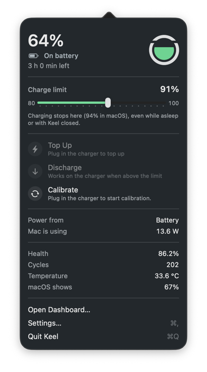

Keel is a battery charge limiter for Apple silicon MacBooks. It lives in the menu bar and stops charging at the level you choose, from 80 to 100%, so a Mac that sits on the charger all day isn't held at 100%, which wears the battery faster.

## How it works

macOS 26.4 added a charge limit of its own. Keel drives that same limit, so:

- The limit holds while the Mac sleeps, after a restart and when Keel is closed. macOS enforces it, not Keel.
- Above the limit on the charger, macOS runs the Mac from the battery until it is back down.
- Any whole number from 80 to 100% works. macOS doesn't accept lower limits, so neither does Keel.
- macOS still charges to 100% now and then to recalibrate its battery gauge. Keel shows this as "macOS is charging"; it goes back to your limit afterwards.

The limit is set through a private macOS framework (PowerUI), loaded at runtime and checked before every call. If a macOS update changes it, Keel says the limit is unavailable instead of guessing.

## Features

**In the menu bar**
- The Keel mark fills to your battery level, with the line at your limit. You can switch to state symbols, an iPhone-style battery or a small graph of the last half hour.
- The popover shows the level, what the battery is doing, the limit slider, power in and out, health, cycles and temperature. Hold or right-click a section to hide or reorder it.

**Charging**
- **Top Up:** charge to 100% once, for a trip, and go back to the limit after you unplug.
- **Discharge:** on the charger, run on the battery down to the limit.
- **Calibrate:** charge to 100%, run down to 10%, charge to 100% again, hold for an hour, then return to the limit, so the percentage reading stays accurate.
- **Heat protection:** pause charging while the battery is hot.
- **Hardware percentage:** show and limit by the battery chip's own reading (remaining over full charge capacity) instead of the smoothed figure macOS shows. On the chip's scale a high limit can equal 100% for macOS, and Keel tells you when it does.

**Automation**
- Schedules (for example, Top Up before a calendar event), limits per Wi-Fi network, keyboard shortcuts and Shortcuts actions.

**Insights**
- A dashboard with the charger's name, rating and real power, charge, power and temperature history, charging sessions, daily health with a forecast, and apps using a lot of energy (macOS's own processes get plain names; `WindowServer` is the process that draws the screen).
- English, Portuguese, French, Spanish and German.

## The helper

The charge limit needs no special rights. Three features do: Calibrate and Discharge cut the charger inside the Mac (an SMC key), and Keel can drive the MagSafe light and keep the Mac awake with the lid closed until it reaches the limit. These go through a small root helper, installed with `SMAppService` after you approve it in System Settings > General > Login Items.

- The helper only accepts connections from Keel signed by the same team.
- It never lets the battery go below 10% with the charger cut.
- When Keel disconnects, quits or the helper stops, it reconnects the charger and puts the light and sleep back to the system defaults.

Without the helper, the limit, Top Up and everything else still work.

## Install

Keel isn't notarised, so build it yourself:

1. Requirements: an Apple silicon MacBook on macOS 26.4 or later, Xcode 27, and [XcodeGen](https://github.com/yonaskolb/XcodeGen) (`brew install xcodegen`).
2. In `project.yml` and `Shared/HelperProtocol.swift`, replace the team ID `R87873B42W` and the `com.abiodunosagie` bundle IDs with your own. The app and the helper check each other's signature, so they must be signed by your team.
3. Run `./scripts/build.sh`. It builds a Release copy, installs it to `/Applications/Keel.app` and opens it.

Tests: `./scripts/test.sh`. They use a fake charge backend and never touch powerd, the helper or the SMC.

## Removing Keel

Settings > General > Remove Keel puts back the charge limit macOS had before Keel, removes the helper and the login item, and moves Keel to the Trash.

## License

MIT. See [LICENSE](LICENSE). The word in the logo is set in Schibsted Grotesk (SIL Open Font License 1.1, [brand/fonts/OFL.txt](brand/fonts/OFL.txt)).
